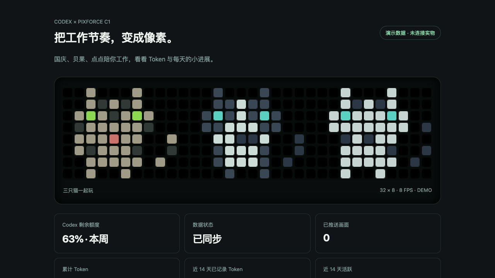

# PixForce Codex Dashboard

让旧像素时钟显示 Codex 用量，顺便让三只猫陪你工作。

一个本地运行的 **32×8 像素看板与动画服务**：真实额度、累计 Token、近 14 天活动、国庆 / 贝果 / 点点，以及火箭、代码雨、烟花等 19 种画面。支持没有硬件的演示模式，也能通过原有 Awtrix 接收应用连接 PixForce C1。

[English overview](README.en.md) · [设备与协议](docs/hardware.md) · [数据口径](docs/data.md) · [分享录制提纲](docs/recording-guide.md)



> 非官方个人项目，与 OpenAI、PixForce、AWTRIX 无隶属关系。当前实物只验证过一台 PixForce C1 32×8、原固件 1.4.1.35e8735；其他型号或版本需要自行验证。本仓库不包含设备固件、刷机工具或 Wi-Fi 恢复备份。

## 先看演示

需要 Node.js **22.21 或以上版本**。没有第三方运行依赖，也不需要先安装 Codex。

```sh
git clone https://github.com/paul010/pixforce-codex-dashboard.git
cd pixforce-codex-dashboard
npm run demo
```

打开 **[本机控制台](http://127.0.0.1:8788/)**。页面会明确显示“演示数据 · 未连接实物”，使用虚构统计，不读取账号、不监听 MQTT、不写入设备。

如果端口被占用，可在 `.env` 设置 `PIXFORCE_HTTP_PORT=8878`。应用使用 Node 自带的环境文件加载功能。

## 显示自己的 Codex 数据

安装并登录官方 Codex CLI，先确认 `codex login status` 正常，再运行：

```sh
npm start
```

默认仍是**网页预览**，不会连接或修改时钟。服务通过本机 `codex app-server` 读取账户额度与用量，每分钟刷新；不读取对话、不扫描本地会话日志、不打印凭据，也不发送模型生成请求。

`account/usage/read` 属于依赖当前 CLI / 账号能力的数据接口；无法获取时显示缺失值，不用会话累计量伪装账户累计量。参考 [OpenAI App Server 文档](https://learn.chatgpt.com/docs/app-server)。本项目不需要新增 API Key，但正常账户读取仍使用已登录 Codex 的网络连接。

## 连接 PixForce C1

时钟需要已经能连接局域网，且原固件提供本地 WebSocket 和 Awtrix 应用。本项目不处理 Wi-Fi 密码，也不会刷写固件。

```sh
cp .env.example .env
```

编辑 `.env`，填写：

| 变量 | 用途 |
| --- | --- |
| `PIXFORCE_IP` | 时钟的局域网 IPv4 地址，必填 |
| `PIXFORCE_HOST_IP` | 时钟能够访问的电脑 IPv4 地址，建议明确填写 |
| `PIXFORCE_HTTP_PORT` | 仅本机可访问的控制台，默认 8788 |
| `PIXFORCE_MQTT_PORT` | 时钟接收画面的本地 MQTT 端口，默认 18884 |
| `PIXFORCE_FPS` | 4 或 8，默认 8 |
| `CODEX_BIN` | 可选，Codex CLI 可执行文件路径 |

然后运行：

```sh
npm run clock
```

**这一步会修改 Awtrix 应用的服务器地址、端口和轮播时长，并手动进入该接收应用。** 其他显示应用保留；已有接收应用会被复用，未找到时创建一个。配置写入后必须回读一致才继续。

网页中可选单个画面、自动轮播、切回原时钟和调整帧率。正常退出服务会尝试恢复原时钟。电脑休眠、断网或强制终止时无法保证自动切回，可用设备按键切换。电脑和时钟地址变化后需更新配置。

## 画面与数据

- **额度 / 时钟 / 重置倒计时**：主 Codex 额度与 Spark 分开，缺失或重置过期的额度不显示成零。
- **累计 Token**：账户 `summary.lifetimeTokens`；小屏以 K / M / B / T 缩写，网页显示完整数字。
- **近 14 天**：每天一根柱子，左旧右新，金色是今天；缺失日期为灰色缺口，确认零用量为亮点。网页显示日期、逐日数值、已记录合计和活跃天数。
- **三只猫**：国庆虎斑、贝果深色面部配白中线、点点白底带斑；各自动画和三猫同屏，包含眨眼、踏步、摇尾和抬爪。
- **其他动画**：机器人、火箭、吃豆人、代码雨、彗星、烟花、海浪、心跳、星际穿梭、彩虹。

这里的 Token 是账户已用量，**不代表剩余 token、账单或可用资金**。近 14 天包含今天，保留接口给出的日期标签；未知日期不纳入合计。细节见 [数据口径](docs/data.md)。

## 测试与扩展

```sh
npm test
```

测试覆盖协议 CRC / 坏帧、合成设备样例、RGB565、MQTT 分段订阅、19 种画面、日期及缺失值、独立账户客户端、配置校验、本地 HTTP 控制与来源限制。测试不依赖实物或真实账号。

| 文件 | 作用 |
| --- | --- |
| `server.mjs` | 本地控制台、调度、设备连接 |
| `account.mjs` | 独立 Codex App Server stdio 客户端 |
| `render.mjs` / `cats.mjs` | 像素画面与三只猫 |
| `metrics.mjs` | 账户指标和 14 天聚合 |
| `c1.mjs` / `mqtt.mjs` | C1 WebSocket 配置、Awtrix 帧发送 |
| `demo.mjs` | 仅用于预览的虚构数据 |

增加画面时在 `SCENES` 注册，并在 `render()` 返回 256 个 RGB 像素；每个通道为 0–255。自动轮播顺序在 `server.mjs` 的 `SEQUENCE` 中。

## 运行边界

网页只绑定回环地址，写操作检查本地凭证和来源。硬件模式的 MQTT 只绑定指定电脑 IP，并过滤时钟来源 IP；**IP 过滤不是身份认证**，请只在可信家庭局域网使用，不做公网端口转发。服务不提供 TLS，也没有经过独立安全审计。

演示模式可跨平台运行；实物桥接目前只在 macOS 验证。系统登录自动启动可参考 [macOS 说明](docs/macos-autostart.md)，本仓库不会自动修改系统启动项。

## 来源与许可

本仓库的原创 JavaScript、程序像素猫和文档采用 [MIT License](LICENSE)。没有包含原设备固件、第三方项目源码或用户恢复备份。

感谢 [yinbaiyuan 的 Dot2d / PixForce 项目](https://github.com/yinbaiyuan/Dot2d_esp32)、[Awtrix 接收说明](https://www.yinbaiyuan.com/doc/16/) 和 [AWTRIX2.0 Controller](https://github.com/yinbaiyuan/AWTRIX2.0-Controller) 提供设备背景和通信格式参考。具体来源与许可边界见 [NOTICE](NOTICE.md)。
