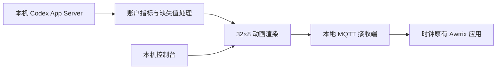

# 设备支持与协议笔记

## 验证范围

已验证一台 PixForce C1：32×8，ESP32，原固件 `1.4.1.35e8735`，macOS 主机。上游 Dot2d 仓库是设备背景，不能把其中的示例固件直接当成这台设备当前固件。

设备须已联网。发现 USB / 蓝牙或打开路由器页面不等于完成网络恢复。本仓库只提供显示桥接，不提供通用 Wi-Fi 恢复或刷机流程。

## 数据流

## C1 本地 WebSocket

入口为设备局域网地址的 `/ws`。二进制包为：

- 长度：大端 16 位，表示其后数据长度。
- 操作码：1 字节。
- 操作负载。
- CRC16 Modbus：初值 `0xffff`、多项式 `0xa001`，校验操作码和负载，CRC 小端。

本项目用到读取应用列表（24）、读取配置（25）、添加应用（21）、写应用配置（26）和手动播放（16）。只有用户显式运行硬件模式才写入设备；Awtrix 应用类型为 7，原时钟类型为 1。

配置写入后逐字节回读。接收应用时长设为零，避免加入原自动轮播；结束服务时尝试手动回到原时钟。设备当前原应用不删除，但原有 Awtrix 接收地址会被新设置覆盖。不同固件请先核对格式。

## Awtrix 画面

MQTT 订阅前缀为 `awtrixmatrix/`。发送到 `awtrixmatrix/codex`：

1. DrawBMP：命令字节 1，x / y 为大端 16 位，宽 / 高各 1 字节，后接逐行 RGB565 大端像素。32×8 共 519 字节。
2. Show：单字节命令 8。

局域网 MQTT 不带 TLS / 账号认证，来源 IP 过滤只是范围限制。不要暴露公网端口。时钟或主机换地址后更新 `.env`。

正常退出会尝试回到时钟；电脑休眠、网络中断、断电或强制终止无法保证这一动作。设备按键仍是人工切换方式。测试样例为合成数据，未分发任何真实设备身份或固件。
