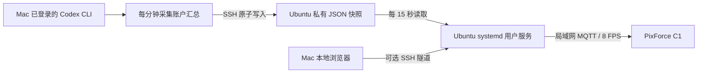

# Ubuntu 常驻显示，Mac 同步统计

把动画和画面发送放在持续开机的 Ubuntu 上，Mac 只负责提供 Codex 统计。Mac 锁屏、睡眠或暂时离线时，猫咪和时钟仍由 Ubuntu 运行；统计超过 3 分钟标记待更新，超过 5 分钟隐藏旧数值。恢复连接后继续同步。



两条链路独立：Mac 断开只影响统计新鲜度和 Mac 上的管理入口，不影响 Ubuntu 的动画。Ubuntu 无需安装或登录 Codex，也不接收账户凭据、对话、会话日志或 API Key。

## 准备条件

- 一台持续开机的 Ubuntu、Node.js **22.21+**、Python 3、SSH 和可用的 `systemctl --user`。先用 `node --version`、`python3 --version` 检查；Node 需在启动服务前安装好，安装器不下载软件。
- Mac 上安装并登录官方 Codex CLI，`codex login status` 正常。用 `command -v node` 和 `command -v codex` 查绝对路径。
- Ubuntu 与时钟能互通。时钟已连 Wi-Fi，原固件有 WebSocket 和 Awtrix 接收应用。
- Mac 已能用指定 SSH 身份非交互连接 Ubuntu，并已核对主机身份、写入 `known_hosts`。同步端使用 `BatchMode=yes` 和严格主机校验，不自动接受新主机密钥；需要 passphrase 的私钥请提前载入可用的 SSH agent。
- 建议为 Ubuntu 和时钟保留固定的局域网地址。虚拟机的宿主机也必须保持运行；Ubuntu 的用户服务无法阻止宿主机睡眠。

以下所有地址、用户名和路径均需填写自己的配置。本仓库不附带作者的部署配置或 SSH 身份。

## 1. 在 Ubuntu 准备显示服务

用**最终运行服务的普通用户**登录 Ubuntu：

```sh
git clone https://github.com/paul010/pixforce-codex-dashboard.git
cd pixforce-codex-dashboard
cp .env.example .env
printf '\nPIXFORCE_METRICS_FILE="%s"\n' "$HOME/.local/share/pixforce-dashboard/metrics-snapshot.json" >> .env
chmod 600 .env
```

编辑 `.env` 中的 `PIXFORCE_IP` 和 `PIXFORCE_HOST_IP`：前者是时钟地址，后者是**时钟能访问的 Ubuntu 局域网地址**，不能填 Mac 地址或回环地址。端口默认是 HTTP `8788`、MQTT `18884`，帧率默认 `8`。

`PIXFORCE_METRICS_FILE` 必须保留上面生成的绝对路径，匹配 SSH 接收端写入位置；Node 环境文件不会替你展开 `$HOME`。设置此项后显示服务只读快照，不调用 Ubuntu 上的 Codex 客户端。

```sh
# 只核对配置和环境，不连接时钟、不写入服务。
bash deploy/install-user-service.sh "$PWD/.env" --check
# 安装到当前用户目录，仍不启用或启动。
bash deploy/install-user-service.sh "$PWD/.env"
```

安装器会复制必要运行文件，记录 Node 绝对路径，生成：

- 应用：`~/.local/share/pixforce-dashboard/`
- 用户单元：`~/.config/systemd/user/pixforce-dashboard.service`

已有安装时会拒绝覆盖。无需 `sudo` 安装应用。管理员需确认该用户的 linger 已开启，让服务在注销后和系统启动时也能运行：

```sh
loginctl show-user "$USER" -p Linger
# 仅在尚未启用时，由管理员执行：
sudo loginctl enable-linger "$USER"
```

服务单元使用 `Restart=on-failure` 和 5 秒重试；程序每 5 秒检查实际 MQTT 订阅，断线或启动时设备离线也会继续尝试。手动选择“回到原时钟”会暂停自动接管。

## 2. 放行时钟的接收端口

如果 Ubuntu 启用了 UFW，先把自己的两个地址填入下面变量，再由管理员执行规则。仅放行时钟访问 MQTT；HTTP 控制台保持绑定回环，不对家庭网络开放：

```sh
read -r -p '时钟 IPv4: ' CLOCK_IP
read -r -p 'Ubuntu IPv4: ' DISPLAY_IP
sudo ufw allow proto tcp from "$CLOCK_IP" to "$DISPLAY_IP" port 18884 comment 'PixForce clock only'
sudo ufw status
```

如果改了 MQTT 端口，规则也要同步修改。不要为了排障关闭整个防火墙，也不要做公网端口转发。Ubuntu 能访问时钟 WebSocket，不代表反向的时钟到 MQTT 端口也已放通。

## 3. 在 Mac 配置统计同步

Mac 也克隆本仓库。复制同步配置：

```sh
cp deploy/mac-relay.env.example .env.relay
chmod 600 .env.relay
```

填写 `.env.relay`：

| 变量 | 填写内容 |
| --- | --- |
| `CODEX_BIN` | `command -v codex` 得到的绝对可执行路径 |
| `PIXFORCE_SSH_KEY` | 已有 SSH 私钥的绝对路径，不要把私钥内容粘贴进来 |
| `PIXFORCE_SSH_TARGET` | Ubuntu 的 `用户名@主机名` 或 `用户名@IPv4` |

支持带空格的路径，环境文件中的值可以加双引号。不依赖个人知识库、Kindle Dashboard 或任何仓库外的采集器。

```sh
# 先试一次，成功时只打印 aggregate snapshot delivered。
node --env-file=.env.relay deploy/mac-metrics-push.mjs --once
```

在 Ubuntu 检查快照文件已产生，权限为 `600`：

```sh
ls -l ~/.local/share/pixforce-dashboard/metrics-snapshot.json
```

同步端通过 SSH 执行 Python，使用临时文件和 `os.replace` 原子替换 JSON。只发送重建后的白名单字段：

| 字段 | 用途 |
| --- | --- |
| `schemaVersion` / `capturedAt` | 格式版本和 Mac 的源采集时间 |
| `quota` | 主额度窗口、已用百分比、重置时间 |
| `tokensTotal` | 账户累计 Token；缺失为 `null` |
| `activity.days` | 14 个日期和各日 Token；未知为 `null` |

CLI / 账户不支持某个数据接口时，该字段保持未知，不以会话日志或零值替代。不能从一次成功传输推断所有指标均可获取，要检查网页上的各项状态。

## 4. 切换并核对实物

**先停止 Mac 或其他主机上原来的硬件画面服务**，避免两端争抢同一个时钟。统计同步端可以继续运行，它不会控制硬件。

在 Ubuntu 启动并启用常驻：

```sh
systemctl --user enable --now pixforce-dashboard.service
systemctl --user status pixforce-dashboard.service
journalctl --user -u pixforce-dashboard.service -n 30 --no-pager
```

这一步会把时钟的 Awtrix 接收应用切到 Ubuntu 地址；保留原时钟和其他应用，不刷固件。接收器设置需要回读一致才能继续。只有实物轮播和数据核对正常后，再停用原主机的自动启动项，保留作回退。

Mac 可开一条仅本机可访问的 SSH 隧道。把 `YOUR_KEY` 和 `YOUR_TARGET` 替换为自己的路径、`用户名@主机名`：

```sh
ssh -NT -L 127.0.0.1:8788:127.0.0.1:8788 \
  -i YOUR_KEY -o IdentitiesOnly=yes -o BatchMode=yes \
  -o StrictHostKeyChecking=yes -o ExitOnForwardFailure=yes \
  -o ServerAliveInterval=15 -o ServerAliveCountMax=2 YOUR_TARGET
```

打开 [Mac 本地管理页](http://127.0.0.1:8788/)。旧 Mac 服务如仍占用 8788，应先停止；本项目的 Host / Origin 检查要求隧道本地端口与 Ubuntu `PIXFORCE_HTTP_PORT` 相同。若换端口，两端保持一致。

**SSH 身份若配置了 `no-port-forwarding`，可同步文件，但不能建立这条隧道。** 使用已有允许本地转发的身份，或直接在 Ubuntu 本机浏览器查看；不要删除原有限制来尝试“修复”同步。隧道是管理入口，Mac 断开隧道不影响时钟动画。

检查 Ubuntu 本地状态：

```sh
curl --noproxy '*' -fsS http://127.0.0.1:8788/api/state
```

应看到 `mqtt: "subscribed"`、`deviceClients: 1`、`enabled: true`、`activation.readback: true`。`macIP` 是兼容旧版本保留的字段名，在此方案中应等于 Ubuntu 地址；`dataSource` 应为 `Mac aggregate snapshot`。隔几秒读取，`frames` 持续增长才说明实际在发送画面。网页能打开并不足以证明实物已连接。

## 5. 让 Mac 登录后自动同步

手动同步及各项指标核对通过后，在 Mac 运行：

```sh
node --env-file=.env.relay deploy/install-mac-relay.mjs
launchctl print "gui/$(id -u)/org.pixforce.metrics-relay"
```

安装器仅支持普通 macOS 登录用户。它生成该用户的 LaunchAgent，并复制所需的独立客户端和同步程序到 `~/Library/Application Support/PixForceDashboardMetrics`，不硬编码作者的用户名、IP、私钥位置或 CLI 路径。已有安装会拒绝覆盖。

新同步服务每分钟采集一次，失败后下一轮重试，不重叠执行。它在**登录后**运行；Mac 睡眠时不会同步，也不阻止 Mac 睡眠。日志在上述运行目录中的 `metrics-push.log` 和 `metrics-push-error.log`。

管理页隧道可在需要时手动开启；此安装器只配置统计同步，不创建后台隧道、不改 SSH 授权或防火墙。

## 6. 验收与回退

建议检查这几项实际行为：

1. 三猫、时钟和统计画面在实物上正常轮播，统计值与 Mac 账户显示一致。
2. `systemctl --user restart pixforce-dashboard.service` 后重新订阅、帧数增长。
3. 在网页选择“回到原时钟”，等待至少 5 秒不会被抢回；“自动轮播”能重新连接。
4. 停止 Mac 同步，保持 Ubuntu 运行，等待超过 3 分钟。网页应标记待更新，动画继续。说明文字最多晚一个 15 秒快照刷新周期；超过 5 分钟过期数值会隐藏。
5. 重新启动 Mac 同步，快照时间更新，最迟下一轮读取后恢复已同步。日期缺失仍显示未知，不计为零。

暂停 / 恢复此文生成的 Mac 同步服务：

```sh
launchctl bootout "gui/$(id -u)" "$HOME/Library/LaunchAgents/org.pixforce.metrics-relay.plist"
launchctl bootstrap "gui/$(id -u)" "$HOME/Library/LaunchAgents/org.pixforce.metrics-relay.plist"
```

若 Ubuntu 不能接管，按顺序回退：

```sh
# Ubuntu：先停止并取消自动启动。
systemctl --user disable --now pixforce-dashboard.service
```

再停止 Mac 管理隧道，释放本地 8788，最后恢复原 Mac 硬件服务及其启动项。不要同时启动两个硬件服务。保留原运行目录、配置和启动项，完成迁移前不要删除。

## 验证范围与已知限制

2026-10-29 在一台 Ubuntu 22.04 x86_64 虚拟机、Node 22.23.4 和同一台原固件 PixForce C1 上完成实际部署。确认了接收配置回读、MQTT 订阅、实物轮播、服务重启恢复、手动原时钟模式保持；实际暂停 Mac 汇总源超过 3 分钟后动画继续，恢复后重新同步。常驻部署沿用已有的 Mac 账户采集器；开源同步端改用本仓库独立 App Server 客户端，已在 Mac 核对真实账户字段，并完成一次到 Ubuntu 的真实 SSH 同步。另有白名单、SSH 流传输、私有文件权限及失败保留旧快照的自动测试。没有宣称整台虚拟机或宿主机重启测试完成。

SSH 连接并不加密 Ubuntu 到时钟的 MQTT；后者仍只适用于可信局域网。更换 Ubuntu / 时钟地址后，需要更新 `.env`、防火墙规则和 Mac SSH 目标。不要提交 `.env`、`.env.relay`、真实快照、私钥、运行日志、个人 LaunchAgent 或设备恢复备份。
